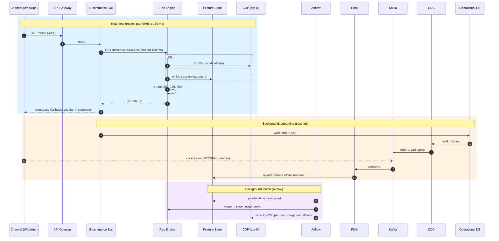

# Session 1: Use-case flow view: homepage recommendations for a returning user

**Diagram:** [homepage-recs-flow.drawio](homepage-recs-flow.drawio). Open it in [app.diagrams.net](https://app.diagrams.net) or the VS Code Draw.io extension. Page 1 shows the chosen option and page 2 the rejected one.

**Scenario.** A known customer opens the Noon/Amazon-style app. The homepage shows 20 personalized products. Target: **P95 ≤ 150 ms server side**. The homepage must still render when ML is down.

## Two paths, kept apart

- **Real-time request path** (the user is waiting): Channel → API Gateway → E-commerce service → Recommendation engine. The engine reads (a) the **precomputed top-200 candidates** from the CDP and (b) **fresh session features** from the online feature store, in parallel. It re-ranks them to 20 and filters out items already bought or out of stock. The E-commerce service then hydrates the product cards from its catalog cache. If the engine misses its 100 ms timeout, the page falls back to the *popular-in-segment* list.
- **Background path** (nobody waits):
  - *Streaming, seconds:* Operational DB → **CDC** (reads the DB log, never queries it) → **Kafka** → **Flink** → online and offline feature store.
  - *Batch, nightly/hourly:* **Airflow** builds the training set, retrains the ranker, batch-scores active users, and writes top-200 per user plus segment fallbacks to the **CDP**.

## Options compared

| | **A. Precomputed top-K + real-time re-rank (chosen)** | **B. Real-time Vector DB query per request** |
|---|---|---|
| Latency (P95) | ~85 ms (key lookups only) | ~135–165 ms; ANN tail latency grows with load |
| Cost | Compute once per user per night, off-peak | Vector DB and embedding model sized for Ramadan peak, 24/7 |
| Operational DB load | Zero (CDC) | Zero (CDC), but adds a hard runtime dependency |
| Freshness | Candidates up to 1 h old; session features fix the ranking | Reacts to the last click |

**Decision: A.** It meets P95 with 65 ms of headroom, it's the cheapest, and the fallback keeps the homepage up. Its staleness weakness is covered by Flink session features. **Revisit B** if the catalog changes hourly, or if an A/B test shows session-aware retrieval adds enough CTR to pay for it.

## Over-engineering check (against the high-level view)

- **Missing:**
  - **Clickstream collector**: views and clicks never reach the DB, so CDC can't capture them.
  - **Model registry** (MLflow).
  - **Catalog cache** in the E-commerce service.
  - **Monitoring** of CTR and top-K staleness.
- **Not needed:**
  - **WhatsApp**: it belongs to a different use case.
  - **Vector DB**: nothing needs real-time similarity search here, and the batch job can do ANN in memory.
  - **Flink** is justified *only* because session freshness matters. Without that, hourly Airflow would be enough.

## Latency budget (P95)

| Hop | Gateway + TLS | Route | Call recs | CDP ∥ feature store | Re-rank | Hydrate | Return | **Total** |
|---|---|---|---|---|---|---|---|---|
| ms | 10 | 5 | 5 | 10 | 30 | 15 | 10 | **85**, plus 65 headroom = **150** |

**Assumptions:**
- 1M daily active users × 3 homepage loads ≈ 35 QPS on average, about 350 QPS at a Ramadan peak (10×).
- Top-K storage: 1M × 200 IDs × 8 B ≈ 1.6 GB, which fits in memory. That's why a key lookup is cheap.

Same flow as Mermaid (renders on GitHub)

